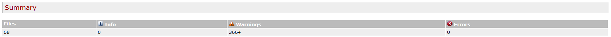

# Checkstyle (estático no funcional, caja blanca)

**Criterio rúbrica:** unitarias estáticas no funcionales — aplicar la técnica y derivar pruebas o issues.

## Herramienta

| Campo | Valor |
|-------|-------|
| Plugin | `maven-checkstyle-plugin` |
| Reglas | `google_checks.xml` |
| Alcance | `includes` en `pom.xml` (clases de la práctica + tests asociados) |
| Fallo del build | `failOnViolation=false` (informa sin tumbar) |
| Informe HTML | `target/site/checkstyle.html` |
| Informe XML | `target/checkstyle-result.xml` |

## Cómo regenerar

```bash
mvn test
start target/site/checkstyle.html
```

## Evidencia



## Resultados

- **68** ficheros analizados; **3664** warnings; 0 errors (resumen del HTML).
- Causa principal: código base original con **tabs** e indentación distinta a Google Java Style (espacios, longitud de línea, llaves, etc.).
- No son bugs funcionales: son **deuda de estilo**.

## Acción derivada

Documentado en la issue [#17](https://github.com/pablojhdcoder/vvs-udc/issues/17): alinear a Google Checks o relajar reglas en una tarea futura. En esta entrega **no** se reformatea todo el legado (ruido enorme, poco valor de verificación). Los tests nuevos se escriben con un assert por método y nombres claros; el informe sigue reflejando el legado.
