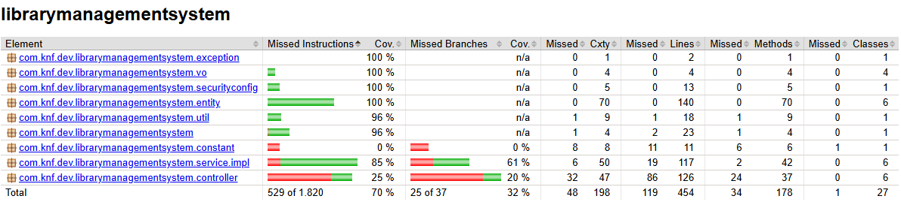

# Análisis de cobertura (JaCoCo)

**Criterio rúbrica:** análisis de cobertura — 100% o justificación de cobertura inferior.

## Herramienta

| Campo | Valor |
|-------|-------|
| Plugin | `jacoco-maven-plugin` (`pom.xml`) |
| Ejecución | fase `test` (`prepare-agent` + `report` + `check`) |
| Informe HTML | `target/site/jacoco/index.html` |
| CSV | `target/site/jacoco/jacoco.csv` |

### Gates automáticos (fallan el build)

- `Author` + `AuthorServiceImpl`: **100%** líneas y ramas
- `Book` + `BookServiceImpl`: **100%** líneas y ramas

## Cómo regenerar

```bash
mvn test
start target/site/jacoco/index.html
```

## Evidencia



## Resultados

Cobertura **global** (instrucciones del informe HTML): **70%**. El gate formal de la práctica está en Author/Book, no en el global. El paquete `entity` aparece al **100%**.

| Clase | Líneas | Ramas | Gate |
|-------|--------|-------|------|
| Author | 100% | n/a | sí |
| AuthorServiceImpl | 100% | 100% | sí |
| Book | 100% | n/a | sí |
| BookServiceImpl | 100% | 100% | sí |
| Category | 100% | n/a | — |
| CategoryServiceImpl | 100% | n/a | — |
| Publisher | 100% | n/a | — |
| PublisherServiceImpl | 100% | n/a | — |
| User | 100% | n/a | — |
| UserServiceImpl | 100% | 100% | — |
| Role | 100% | n/a | — |
| Mapper | 94,4% | n/a | — |

## Significado

El 100% en Author/Book indica que **cada línea/rama se ejecutó al menos una vez**, no que no haya bugs. Por eso se combina con particiones, fronteras, jqwik, PITest y SpotBugs.

`Mapper` al 94,4%: una línea residual (camino ya cubierto de forma equivalente por otras propiedades). Fuera del gate; se prioriza mutación y estático sobre el último porcentaje cosmético.

## Justificación de cobertura inferior (fuera de alcance)

| Componente | Motivo |
|------------|--------|
| Repositorios Spring Data | Interfaces sin lógica; se ejercitan en `integration/` |
| Controllers (salvo Category) | Adaptadores finos; patrón cubierto en `CategoryControllerTest` |
| `FileServiceImpl` / export | Fuera del subconjunto de la práctica |
| `SecurityConfiguration` / `Item` / `Application` | Configuración o arranque; contexto en `@SpringBootTest` |
