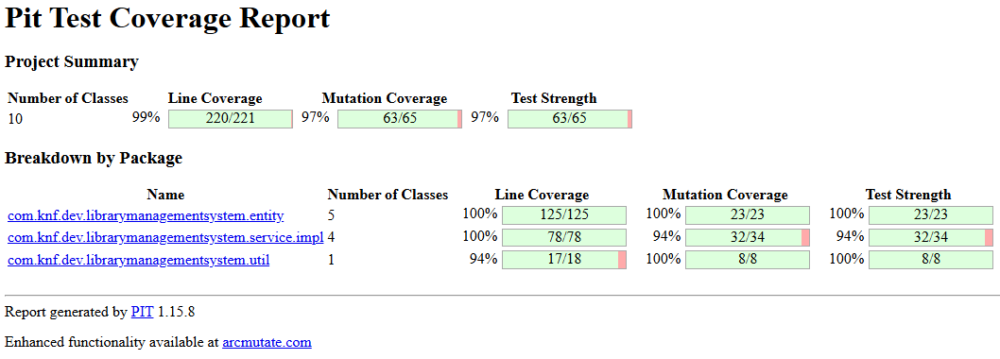

# Análisis de mutación (PITest)

**Criterio rúbrica:** calidad de las pruebas — incorporar la herramienta y derivar pruebas o issues de los hallazgos.

## Herramienta

| Campo | Valor |
|-------|-------|
| Plugin | `pitest-maven` + `pitest-junit5-plugin` |
| Umbral | `mutationThreshold` = **90** |
| Objetivos | Author, Book, Publisher, User, Role, Mapper y services / tests asociados (`pom.xml`) |
| Informe HTML | `target/pit-reports/index.html` |

## Cómo regenerar

```bash
mvn clean test-compile org.pitest:pitest-maven:mutationCoverage
start target/pit-reports/index.html
```

## Evidencia



## Resultados

| Métrica | Valor |
|---------|-------|
| Line coverage (clases mutadas) | 220/221 (**99%**) |
| Mutation score | **97%** (63/65) — supera el umbral 90% |
| Test strength | 97% |
| Mutantes vivos | 2 |

Desglose visible en la captura: `entity` 100% mutación; `service.impl` 94% (2 supervivientes); `util` 100% mutación / 94% líneas.

## Mutantes vivos

Ambos `ConditionalsBoundaryMutator` (`<` → `<=`):

- `AuthorServiceImpl.findPaginated` — `if (size < startItem)`
- `BookServiceImpl.findPaginated` — `if (size < startItem)`

Cuando `size == startItem`, el `else` hace `subList(startItem, startItem)` y también devuelve lista vacía: son **mutantes equivalentes**. No se fuerza un test artificial ni se baja el umbral.

## Acción derivada

Documentado en la issue [#16](https://github.com/pablojhdcoder/vvs-udc/issues/16) (mutante equivalente). No es bug funcional; no se baja el umbral ni se fuerza un test artificial.
